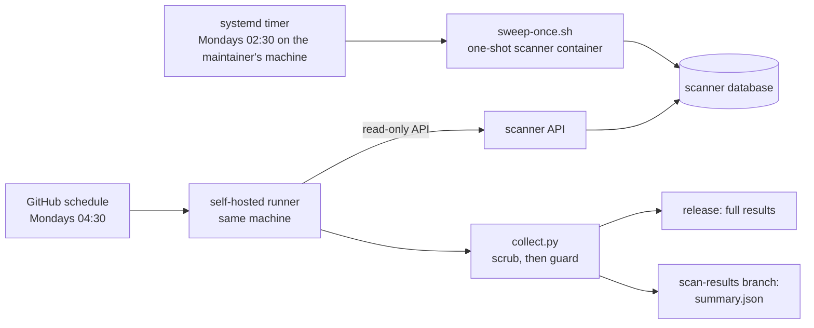

# Weekly scan and publishing

How the scanner runs on a schedule, and how its results reach this public repository.

## Who does what

| Part | Where it runs | What it can do |
| --- | --- | --- |
| `sweep-once.sh` and the systemd timer | the maintainer's machine | scan every connector, write to the scanner database |
| `nightly-scan.yml` | a self-hosted runner on that machine | read the finished grades, publish them |
| `collect.py` | inside the workflow | scrub and write two files, or refuse |

The workflow never scans and never starts containers. The runner has no access to the container engine, so a compromised job could not reach the database or the scan secrets.

## What is published

- **Release** `scan-YYYY-MM-DD`: `full.json`, the full evidence for every connector.
- **Branch** `scan-results`: `summary.json`, grades and reasons only. A commit every week also counts as repository activity, so GitHub does not switch the schedule off after 60 days of quiet.

Internal paths, host names, private addresses and anything shaped like a credential are removed first. A second check then refuses to write the files at all if anything suspicious is left. The rules are covered by `tests/test_collect.py`, in both directions: what must go, and the public package names that must stay.

## Safety rules for the runner

The job runs on a production machine from a public repository.

- Triggers are only the schedule and a manual run. Never add `pull_request`, `push` or issue triggers to a workflow that uses this runner.
- The job refuses to run on forks and on anything but `main`.
- Outside contributors' workflow runs need approval every time, and actions must be pinned to a full commit hash.
- The scan is skipped, not published as new, when the newest scan is more than 9 days old.

## Setup

1. Copy `systemd/*` to `~/.config/systemd/user/` and run `systemctl --user enable --now mcpc-scanner-sweep.timer`.
2. Add the repository secret `SCANNER_API_TOKEN` (same value as the scanner's).
3. Register the self-hosted runner with the labels `self-hosted`, `linux`, `scanner`, on the scanner's container network.

## Keeping the scanner running

The application shows a grade only while the scanner's API container is up, and a reboot stops it. So the
scanner runs as a system service, started at boot the same way the application's own
`host/mcp-connectors.service` starts the application:

    make host-install                                  # checks the units, installs them, enables the scanner
    sudo systemctl start mcp-connectors-scanner
    make host-timer-enable                             # turns on the weekly sweep (off until you ask)
    systemctl status mcp-connectors-scanner

- The unit file is `host/mcp-connectors-scanner.service`. It carries placeholders for the user and the
  checkout, which `make host-install` fills in, so the public repository holds no user name or path.
  `make host-verify` runs `systemd-analyze verify` on the filled-in unit without installing anything.
- It runs as the person who owns the checkout, not as root, and reads its secrets from the gitignored `.env`.
- It starts after the application's service and waits up to two minutes for the networks that service
  creates. It is ordered after it but does not pull it in, because starting the application's unit runs
  `make up`, which recreates the application's containers.
- The container stays in the foreground under systemd (`make serve`), so `systemctl status` says whether the
  scanner is really running, a crash is restarted after ten seconds, and `systemctl stop` stops it.
- Every start runs one sweep first (about five minutes for 300 connectors) and then sleeps for
  `SCAN_INTERVAL_HOURS`, so a reboot costs one extra sweep.

The weekly sweep is installed by the same command, as `host/mcp-connectors-scanner-sweep.service` and `.timer`
(Mondays 02:30, plus up to ten minutes of random delay, with a missed run made up at the next boot). The sweep
unit runs as the same user as the scanner, because the containers belong to that user's rootless podman; a
unit without `User=` would run as root and look in an empty podman. Start one by hand with
`sudo systemctl start mcp-connectors-scanner-sweep`.

Use this or the user units from `make service-install` and `make timer-install`, never both: they would run
the same container and the same sweep twice, and `make host-install` refuses to continue while a user unit is
enabled (`make service-uninstall`, `make timer-uninstall`). The user units suit a machine where you have no root.

Stopping is quick: the container runs with `--init`, so SIGTERM reaches the scanner and `systemctl stop` takes
a second instead of waiting out 30 seconds for a SIGKILL. A stop during a sweep keeps the connectors already
saved and leaves that run without a finish time.

