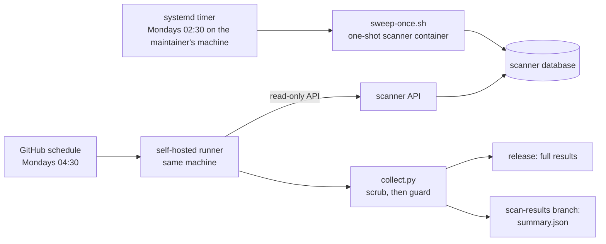

# Weekly scan and publishing

How the scanner runs on a schedule, and how its results reach this public repository.

## Who does what

| Part | Where it runs | What it can do |
| --- | --- | --- |
| `sweep-once.sh` and the systemd timer | the maintainer's machine | scan every connector, write to the scanner database |
| `nightly-scan.yml` | a self-hosted runner on that machine | read the finished grades, publish them |
| `collect.py` | inside the workflow | scrub and write two files, or refuse |

The workflow never scans and never starts containers. The runner has no access to the container engine, so a compromised job could not reach the database or the scan secrets.

## What is published

- **Release** `scan-YYYY-MM-DD`: `full.json`, the full evidence for every connector.
- **Branch** `scan-results`: `summary.json`, grades and reasons only. A commit every week also counts as repository activity, so GitHub does not switch the schedule off after 60 days of quiet.

Internal paths, host names, private addresses and anything shaped like a credential are removed first. A second check then refuses to write the files at all if anything suspicious is left. The rules are covered by `tests/test_collect.py`, in both directions: what must go, and the public package names that must stay.

## Safety rules for the runner

The job runs on a production machine from a public repository.

- Triggers are only the schedule and a manual run. Never add `pull_request`, `push` or issue triggers to a workflow that uses this runner.
- The job refuses to run on forks and on anything but `main`.
- Outside contributors' workflow runs need approval every time, and actions must be pinned to a full commit hash.
- The scan is skipped, not published as new, when the newest scan is more than 9 days old.

## Setup

1. Copy `systemd/*` to `~/.config/systemd/user/` and run `systemctl --user enable --now mcpc-scanner-sweep.timer`.
2. Add the repository secret `SCANNER_API_TOKEN` (same value as the scanner's).
3. Register the self-hosted runner with the labels `self-hosted`, `linux`, `scanner`, on the scanner's container network.
