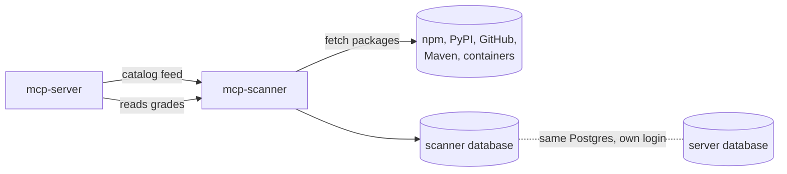
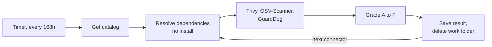
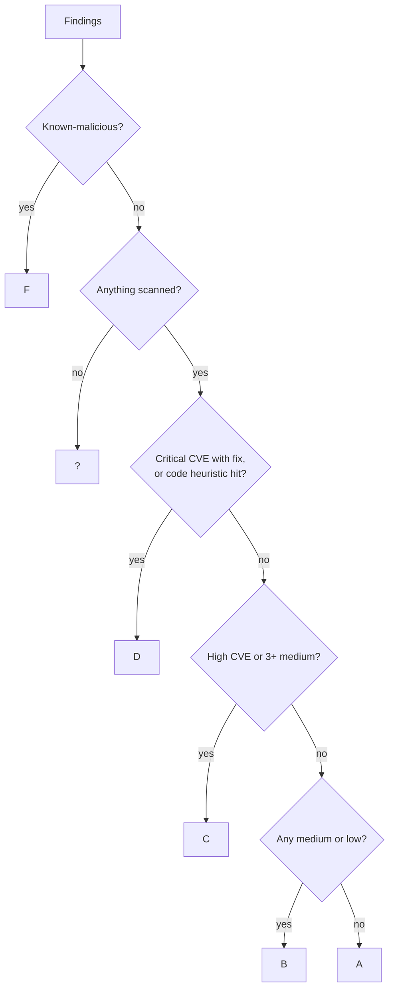

# Connector security scanner

**Audience**: anyone who wants to understand or run the scanner. Read it once to learn it, then use the headings as a reference. Why it is built this way: [ADR 0001](../.docs/adrs/0001-connector-security-scanner-service.md).

## What it is

Once a week the scanner checks every connector in the catalog (about 300), gives it a grade from **A to F**, and publishes the grade, the dependency tree, and what was and was not checked.

- **Separate service.** Own container, own database, own API. The server stores no scan data and only reads grades.
- **Never runs connectors.** It resolves dependencies without installing or executing anything.
- **Never removes anything.** D and F only add a connector to a review list for a human.

## How it fits together



The scanner pulls the connector list from the server, fetches packages from the public registries, and saves results in its own database. If the scanner is off, the website just shows no badge.

## What a sweep does



Each result is saved the moment it is graded, so a crash never loses finished work. Work folders are deleted after every scan, success or failure.

| Tool | Tells us |
| --- | --- |
| **Trivy** | Known vulnerabilities, full package list |
| **OSV-Scanner** | Known vulnerabilities and known-malicious versions |
| **GuardDog** | Suspicious code patterns (npm and PyPI only) |

## How a grade is decided



D and F go on the review list. `?` means not yet assessed: no evidence to grade on.

Every grade needs evidence: with no resolved package there is no grade, and the result reads "not yet assessed". A crashed scanner can never produce an A or B.

**Known issue:** the latest sweep gave 11 A, 4 B, 38 C, 215 D, 32 not assessed. Most D's come from code-heuristic hits on legitimate packages. How we got here and what we plan to change is in the [decision log](./scanner-decision-log.md).

## What it does not check

Published as a coverage matrix on the API and the website, so a grade is never mistaken for a guarantee. Not covered yet: MCP tool poisoning (needs a sandbox decision) and reachability. A means "nothing found by the checks that ran", not "proven safe".

## Running it

Secrets live in `.env.scanner` (gitignored). Back up the database first, because on this host compose has restarted other containers too.

```bash
cd /proj/mcp-connectors
set -a; . ./.env.scanner; set +a
podman-compose -f docker-compose.yaml -f docker-compose.scanner.yaml up -d mcp-scanner-init mcp-scanner
podman logs --tail 20 mcpc-scanner
```

A sweep logs one line per connector, ends with `sweep N done`, then sleeps. Key settings: `SCAN_INTERVAL_HOURS` (default 168), `SCAN_TOOL_TIMEOUT` (300 seconds per tool call).

It is boxed in: read-only filesystem, no capabilities, non-root, in-memory temp space, no published ports, and a database login that cannot open the server's database.

## When something looks wrong

| Symptom | Fix |
| --- | --- |
| No badges on the website | Scanner is down or the token differs; check `podman ps` |
| `sweep failed: HTTP Error 401` | Server and scanner started with different tokens; recreate the older one |
| Scanner stuck on `Created` | Remove it and start again |
| Connector graded `?` | Open its detail; the reason says why |

Code lives in `scanner/engine/`, the compose overlay is `docker-compose.scanner.yaml`, tests are in `scanner/tests/`.
