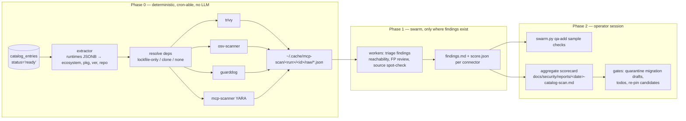

# Connector security-scan engine — research and proposed design

- **Status:** research written before the build. The deterministic engine described here is now built and running; the swarm triage phase (section 5, phase 1) is not built yet. See [`../decision-log.md`](../decision-log.md) for what changed along the way.
- **Date:** 2026-11-12
- **Scope:** all `catalog_entries` with `status='ready'` (~250 connectors after migration 340 + follow-ups)
- **Goal:** recurring white-box + black-box security analysis of the catalog — known CVEs,
  known-malicious versions, malicious-code heuristics, MCP tool poisoning — producing a
  per-connector score, at zero marginal tool cost (OSS only), orchestrated with the
  `docs/agent-swarm/` pattern.

## 1. What we are defending against

| Threat | Example | Detection class |
|---|---|---|
| Known CVE in the connector or its dependency tree | `@hono/node-server` 1.19.19 → CVE-2026-118663 (found in our own `cloudinary-1` pin during this research) | Vulnerability DB match (white-box) |
| Known-malicious published version | typosquats, hijacked releases — OSV `MAL-*` advisories (15k+ records from OpenSSF/GitHub) | Vulnerability DB match |
| Novel malicious code in the package | env-var exfiltration, install-script payloads, obfuscated downloads | Heuristic source scan (white-box) |
| MCP tool poisoning | hidden instructions in tool descriptions, Unicode steganography, lookalike tool names, credential-requesting tools | MCP-specific static scan (black-box on the tool surface) |
| Rug pull | pinned version fine, upstream later republishes or the `latest` drifts malicious | Our pins already freeze versions; re-scan catches newly-published advisories against the pinned version |

White-box = we inspect source and dependency manifests. Black-box = we inspect what the
server presents to a client (tool/prompt/resource descriptions) without trusting the source.

## 2. Tool landscape (researched 2026-11-12)

### CVE / known-malicious matching

- **Trivy** (Aqua, Apache-2.0) — already installed on this workstation (`/usr/bin/trivy`).
  Scans lockfiles/filesystems/container images across npm, PyPI, Go, and more; also does
  secret detection. Broadest single tool; DB refreshes automatically, so re-scanning an
  unchanged pin still surfaces *new* CVEs. **Verified working end-to-end here** (§4).
- **OSV-Scanner v2** (Google, Apache-2.0) — same job against the OSV.dev database, which
  includes the OpenSSF **`MAL-*` malicious-package advisories**. That coverage is the reason
  to run it *in addition to* Trivy: a `MAL-*` hit on a pinned version is an instant quarantine
  signal, not a severity debate.
- **Grype/Syft** (Anchore) — rejected: vuln matching only, no capability Trivy+OSV don't
  already cover, one more toolchain to maintain.

### Malicious-code heuristics

- **GuardDog** (Datadog, Apache-2.0) — CLI that scans **npm, PyPI, Go modules, and GitHub
  Actions** packages with Semgrep/YARA source heuristics + registry-metadata heuristics
  (typosquatting, maintainer-email domain resurrection, env exfiltration, install-script
  payloads…). v3 uses a risk model correlating code capabilities with threat indicators.
  `guarddog npm scan <pkg>` / `guarddog pypi scan <pkg>` work per-package; `verify` walks a
  dependency manifest. SARIF/JSON output. This is the "never-seen-before malware" layer that
  DB matching cannot give. Caveat: heuristic → needs triage (that's what the swarm is for).

### MCP-specific scanning

- **Cisco AI Defense `mcp-scanner`** (Apache-2.0, `uv tool install cisco-ai-mcp-scanner`) —
  **recommended**. Scans MCP tools/prompts/resources/instructions for poisoning. Decisive
  properties for us:
  - The **YARA analyzer runs fully offline, no API key** — fits the zero-cost rule.
  - Input modes match our catalog exactly: **stdio command** (our `runtimes` rows are
    literally stdio commands), remote SSE/HTTP URL, **static JSON snapshot** (scan without
    executing), and **source code**.
  - Optional LLM-judge analyzer accepts any LiteLLM endpoint (could point at Claude later);
    optional pip-audit and VirusTotal (free key) analyzers. Cisco-API analyzer is the only
    paid part — we skip it.
  - JSON output, CLI + Python SDK.
- **mcp-scan (Invariant Labs)** — rejected: absorbed into **Snyk Agent Scan**; analysis now
  routes through Snyk's hosted API, no documented local-only mode, no external contributions.
  Wrong shape for a self-hosted zero-cost pipeline.
- **badchars/mcp-security-scanner**, ghostprobe, MCP-Shield — community projects, less
  provenance; keep as a second-opinion option, not the foundation.
- **Trail of Bits mcp-context-protector** — runtime TOFU proxy, protects a *client* session;
  out of scope for catalog scanning (our pins already give TOFU semantics).

### Repo hygiene (optional dimension)

- **OpenSSF Scorecard** — 0–10 maintenance/hygiene score per GitHub repo (branch protection,
  dependency update tooling, fuzzing…). Free with a GitHub token. Worth adding as a
  *non-gating* score input later; most small MCP repos will score low, so it ranks rather
  than disqualifies.

### Caveat all MCP scanners share

Description-level scanning misses attacks carried in **tool responses** (the GitHub MCP
incident had clean descriptions). Response-side guarding is a runtime concern for the
desktop/gateway, not this engine — captured as a deferred idea, not scope here.

## 3. The catalog side: what the engine has to parse

There are **no structured package/registry/repo columns**. Per connector the engine derives
everything from:

- `catalog_entries.runtimes` JSONB (note: old rows use capitalized `Kind/Command/Args` keys,
  pinned rows lowercase) + `preferred_runtime`
- `catalog_entry_versions` (`is_default=true`) for the pinned version
- `docs_url` for the source repo (usually, not always, a GitHub URL)

Pin spellings in the wild: `pkg@1.2.3` (npx), `pkg==1.2.3` (uvx), `--from git+https://…@ref`
(uvx-from-git), `github:owner/repo#sha` (npx-from-git), `module@vX` (go), image tags
(container/docker). Runtime-kind population across migrations: npx 504, uvx 295, node 55,
go 33, python 32, container 23, docker 5, binary 3, jbang 3 (entries can carry several).

`tools/catalog_validate.py` already resolves package → registry (npmjs, PyPI,
proxy.golang.org, GitHub API, Docker Hub) with stdlib-only code — **reuse its resolution
logic** for the extractor instead of writing a new parser.

## 4. Feasibility verified on this workstation

Smoke test run during this research (no code execution — resolution only,
`--ignore-scripts`):

```bash
npm install @cloudinary/asset-management-mcp@0.11.6 \
    --package-lock-only --ignore-scripts --no-audit   # full tree, nothing executed
trivy fs --scanners vuln .
# → package-lock.json: CVE-2026-118663  @hono/node-server 1.19.19  MEDIUM
```

A real finding in a really-pinned catalog entry, in under ten seconds, with a tool that was
already installed. Per-ecosystem resolution recipes for the pipeline:

| Ecosystem | Resolve (no execution) | Scan |
|---|---|---|
| npm (npx/node) | `npm install <pkg>@<ver> --package-lock-only --ignore-scripts` | `trivy fs`, `osv-scanner`, `guarddog npm scan <pkg> --version <ver>` |
| PyPI (uvx/python) | `uv pip compile` on a one-line `requirements.in` (`pkg==ver`) | `trivy fs` / `osv-scanner` on resolved reqs, `guarddog pypi scan` |
| Go (`go install m@v`) | clone repo at tag (go.mod/go.sum are in-repo) | `trivy fs` / `osv-scanner` on go.sum, `guarddog go scan` |
| git-pinned (npx github:/uvx --from git+) | shallow clone at pinned ref | `trivy fs` on the checkout + lockfile if present, guarddog source rules via local scan |
| container/docker | nothing to resolve | `trivy image <ref>` (OS packages + app deps + secrets) |
| binary/jbang (6 entries) | manual lane | hash lookup (VirusTotal free key) + repo scan; accept partial coverage |
| MCP surface (all) | pinned runtime command | `mcp-scanner --stdio-command … --analyzers yara`, sandboxed, no config/secrets, network-restricted |

To install (all free): `osv-scanner`, `guarddog`, `cisco-ai-mcp-scanner` (uv tool). Trivy is
present. A public-read GitHub token should be exported for the run (swarm lesson: 60 req/h
anonymous limit starves workers; 5k/h with a token).

## 5. Proposed architecture: deterministic pre-pass + swarm triage

The first swarm run's lesson applies directly: LLM workers are the scarce, rate-limited
resource. So the engine never spends a worker turn on anything a shell script can do
deterministically.



- **Phase 0 — `tools/catalog_scan.py`** (stdlib + the four CLIs; reuses
  `catalog_validate.py` resolution). Reads the DB read-only, emits one normalized
  `raw/summary.json` per connector (tool versions, finding counts, max severity, MAL hits,
  YARA hits). Runs in minutes for ~250 connectors, costs nothing, and is the thing the
  schedule actually triggers. Connectors with **zero findings get scored by the script
  alone** — no worker spawned.
- **Phase 1 — swarm** (`runs/security-scan-<date>/registry.json`), same registry schema,
  haiku + medium effort, staggered launches, `deny_tools` Edit/Write on `/proj/**`, sandbox
  under `~/.cache/mcp-scan/<run>/<id>/`. One worker per connector *with findings* (expected
  well under 50 for a typical run), two tasks each mirroring the pin-run shape:
  1. `triage` — read raw findings; for each: is the vulnerable path reachable from the
     connector's entrypoint, is the guarddog/YARA hit a false positive (read the flagged
     source lines in the sandbox clone), does an advisory have a fix version; write
     `findings.md` with evidence (file:line, advisory URL) and `score.json`.
  2. `verify` — second pass re-checking its own claims against live sources (the pin run
     showed self-verification catches real errors even though it is not independent QA).
  `expected_outputs: [findings.md, score.json]` so `swarm.py verify` stays meaningful.
- **Phase 2 — operator QA + aggregation.** Spot-check worker verdicts with
  `qa-add`/`qa-report` (especially every "false positive" dismissal — the dangerous
  direction). Aggregate `score.json`s into a dated report under `docs/security/reports/`,
  committed. Gating actions (status flips, re-pins) stay human-approved migrations, exactly
  like the pin workflow.

### Why the swarm is in the loop at all

Trivy/OSV output on 250 heterogeneous connectors is noisy: unreachable transitive CVEs,
guarddog heuristics firing on legitimate telemetry code, YARA matches on docs. A fixed
script can count findings; it cannot judge them. Triage-with-evidence is exactly the shape
the pin run proved workers do well (and QA caught them when they didn't).

## 6. Scoring model (draft — to refine together)

Start simple, letter grade per connector, computed in `score.json` by rule not by vibes:

| Grade | Rule |
|---|---|
| **F — quarantine** | any `MAL-*` advisory on the pinned version; or confirmed malicious code/tool-poisoning finding | 
| **D** | CRITICAL CVE with triaged-reachable path and a fix available; or unresolved high-confidence heuristic finding |
| **C** | HIGH CVE (reachable) unfixed upstream; or ≥3 MEDIUM reachable |
| **B** | only unreachable/transitive or MEDIUM-and-below findings |
| **A** | clean across all four scanners |

Modifiers (recorded, not gating, v1): pin staleness (pinned_at vs latest upstream release),
OpenSSF Scorecard once added. Proposed policy hooks, for discussion: **F → draft migration
flipping `status='ready'→'preview'`** + todo entry; D → re-pin candidate list in the report.
Numeric 0–100 can come later if the UI wants a dial; letters keep v1 honest.

Persistence (implementation phase, needs its own ADR): a `security_scans` table
(`catalog_entry_id`, `version`, `scanned_at`, scanner versions, `grade`, `findings` JSONB)
rather than widening `catalog_entries`; optionally denormalize `grade`/`last_scanned_at`
onto the entry for UI badges. Also worth considering then: structured
`package`/`registry`/`repo_url` columns so three systems stop re-parsing `runtimes` args
(validator, pin tooling, scanner).

## 7. Scheduling

- **Mechanism:** systemd user timer (WSL2 workstation) → `tools/catalog_scan.py --run-dir …`
  → on findings, generate the swarm registry + print the `swarm.py launch` line (or launch
  directly once we trust it). Cron works too; timer gives journal logs and `Persistent=true`
  catch-up after the machine was off.
- **Cadence:** monthly full scan + ad-hoc after each pin wave. Phase 0 is cheap enough to run
  weekly if wanted — vulnerability DBs update daily, so re-scans of unchanged pins are the
  whole point.
- **Cost envelope:** tools $0; LLM = swarm only, haiku/medium, findings-only workers
  (pin-run smoke test: ~4¢/small task). A monthly run should be low single-digit dollars of
  subscription usage, zero marginal cash.

## 8. Open questions before implementation

1. Is letter-grade + quarantine-at-F the right v1 policy, and should the grade be
   user-visible in the catalog UI or internal-only at first?
2. Phase-1 worker granularity: per-connector (clean QA attribution, more processes) vs
   per-category (fewer launches, muddier QA) — recommendation: per-connector, findings-only.
3. Monthly vs weekly Phase 0; and should the timer auto-launch the swarm or stop at
   "registry generated, human runs launch"? Recommendation for v1: stop at registry.
4. Scope of black-box `mcp-scanner --stdio-command` runs: executing 250 third-party packages
   even sandboxed is the riskiest step. v1 can restrict stdio scanning to connectors whose
   static/source scan is clean-but-suspicious, and lean on static JSON/source modes
   elsewhere. Needs a sandbox decision (bwrap/podman, no network, no HOME).

## Sources

- Snyk Labs — [detecting tool poisoning in MCP servers](https://labs.snyk.io/resources/detect-tool-poisoning-mcp-server-security/)
- [cisco-ai-defense/mcp-scanner](https://github.com/cisco-ai-defense/mcp-scanner) (README, analyzers, input modes)
- [snyk/agent-scan](https://github.com/invariantlabs-ai/mcp-scan) (mcp-scan's successor; hosted-API model)
- [DataDog/guarddog](https://github.com/DataDog/guarddog), [GuardDog 3.0 release notes](https://securitylabs.datadoghq.com/articles/guarddog-3-0-release/), [GuardDog 1.0 (npm support)](https://securitylabs.datadoghq.com/articles/guarddog-1-0-release)
- OpenSSF — [detecting malicious packages via the OSV API](https://openssf.org/?p=11003) (`MAL-*` records, osv-scanner consumption)
- [google/osv-scanner](https://github.com/google/osv-scanner)
- [State of MCP security 2026](https://pipelab.org/blog/state-of-mcp-security-2026/), [AppSecSanta mcp-scan review](https://appsecsanta.com/mcp-scan), [badchars/mcp-security-scanner](https://github.com/badchars/mcp-security-scanner)
